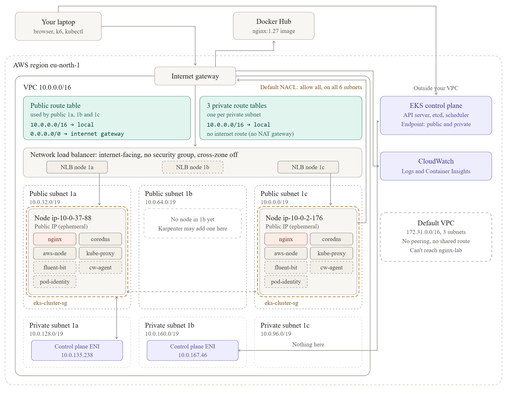

# Kubernetes on AWS EKS: a scalable, observable web service

A hands-on lab that builds a small production-style Kubernetes setup on Amazon EKS, end to end:
network, cluster, workload, load balancing, logging and metrics, IAM for pods, autoscaling, load
testing and a verified teardown. The workload is deliberately simple (nginx) so the focus stays on
the platform around it.

Built on an AWS free-plan account in `eu-north-1` (Stockholm), which added real constraints worth
reading about in [What went wrong and how I fixed it](#what-went-wrong-and-how-i-fixed-it).



## What it covers

| Area | What I set up |
|---|---|
| **Network** | VPC `10.0.0.0/16` created by eksctl: 3 public and 3 private subnets across 3 availability zones, an internet gateway, route tables; NAT disabled to keep costs at zero |
| **Cluster** | EKS cluster `nginx-lab` from a declarative [`cluster.yaml`](cluster.yaml), public and private API endpoints, a managed node group of 2 `t3.small` nodes |
| **Workload** | nginx Deployment with CPU/memory requests and limits, readiness and liveness probes ([`manifests/nginx.yaml`](manifests/nginx.yaml)) |
| **Load balancing** | Service of type `LoadBalancer` provisioned as an AWS Network Load Balancer |
| **Access** | EKS access entries for the CLI user (`AmazonEKSClusterAdminPolicy`) |
| **IAM for pods** | EKS Pod Identity agent, an IAM role trusted by `pods.eks.amazonaws.com` ([`iam/pod-identity-trust.json`](iam/pod-identity-trust.json)), and pod identity associations per service account |
| **Logs and metrics** | `amazon-cloudwatch-observability` add-on: Fluent Bit and CloudWatch agent DaemonSets shipping container logs to CloudWatch Logs and metrics to Container Insights |
| **Pod autoscaling** | metrics-server plus a Horizontal Pod Autoscaler, 2 to 6 replicas at 50% CPU ([`manifests/hpa.yaml`](manifests/hpa.yaml)) |
| **Load testing** | k6 script ramping to 50 virtual users against the load balancer ([`load-test/load.js`](load-test/load.js)) |
| **Node autoscaling** | Karpenter installed with Helm ([`karpenter/karpenter-nodepool.yaml`](karpenter/karpenter-nodepool.yaml)); replaced by Cluster Autoscaler after diagnosing an account restriction |
| **Teardown** | Ordered teardown, then 17 read-only checks across EKS, CloudFormation, EC2, ELB, IAM, CloudWatch Logs, SQS and EventBridge to confirm nothing was left |

A separate piece of AWS work lives in [`lambda/`](lambda): a Python Lambda that deletes stale EBS
snapshots, with a least-privilege IAM policy.

## How the pieces fit

The diagram above is the real layout of the cluster as built. ([SVG version](docs/network.svg))

- Each nginx and CoreDNS pod gets its **own VPC IP address** from the AWS VPC CNI (`aws-node`), separate from its node's IP.
- `aws-node`, `kube-proxy`, Fluent Bit and the CloudWatch agent run as **DaemonSets**, one pod per node, and use the node's network.
- The NLB sends traffic to the nodes, and `kube-proxy` forwards it to a ready nginx pod. The readiness probe keeps a pod out of rotation until it can serve.

## How to run it

Prerequisites: AWS CLI v2, `eksctl`, `kubectl`, `helm` and `k6`, with an AWS identity that can create EKS clusters.

```bash
# 1. Network + cluster + node group (about 15 to 20 minutes)
eksctl create cluster -f cluster.yaml
kubectl get nodes -o wide

# 2. Workload and load balancer
kubectl apply -f manifests/nginx.yaml
kubectl get svc nginx          # wait for EXTERNAL-IP (the NLB hostname)

# 3. Pod Identity + CloudWatch logs and metrics
aws eks create-addon --cluster-name nginx-lab --addon-name eks-pod-identity-agent
aws iam create-role --role-name nginx-lab-cloudwatch-agent \
  --assume-role-policy-document file://iam/pod-identity-trust.json
aws iam attach-role-policy --role-name nginx-lab-cloudwatch-agent \
  --policy-arn arn:aws:iam::aws:policy/CloudWatchAgentServerPolicy
aws eks create-addon --cluster-name nginx-lab --addon-name amazon-cloudwatch-observability \
  --pod-identity-associations serviceAccount=cloudwatch-agent,roleArn=arn:aws:iam::<ACCOUNT_ID>:role/nginx-lab-cloudwatch-agent
aws logs tail /aws/containerinsights/nginx-lab/application --since 10m

# 4. Pod autoscaling and a load test
aws eks create-addon --cluster-name nginx-lab --addon-name metrics-server
kubectl apply -f manifests/hpa.yaml
k6 run -e LB=<nlb-hostname> load-test/load.js
kubectl get hpa nginx -w
```

Node autoscaling (Cluster Autoscaler on the managed node group's Auto Scaling Group) used its own
IAM role through a Pod Identity association, with the node group's maximum raised to 3.

## What went wrong and how I fixed it

The free-plan account blocks several things a normal account allows. Each failure taught me
something about how EKS fits together.

| Problem | Cause | Fix |
|---|---|---|
| Node group hung for about 30 minutes, then rolled back | Free plan only launches free-tier instance types; `t3.medium` is rejected | Switched the node group to `t3.small` |
| `eksctl create addon` failed | An organisation policy (SCP) denies `iam:GetOpenIDConnectProvider`, so IRSA (OIDC) can't be used | Used **EKS Pod Identity** through the plain AWS CLI instead of IRSA |
| Service stayed at `EXTERNAL-IP <pending>` | The new account could not yet create load balancers ("This AWS account currently does not support creating load balancers") | Diagnosed it from the Service events; once the restriction cleared, the NLB provisioned and served traffic |
| The first k6 run did not trigger scaling | CPU peaked at 32% against a 50% target: a static nginx page is cheap, and latency from my laptop to Stockholm capped the request rate | Confirmed metrics-server and the HPA were reading CPU correctly (CPU rose from 2% to 32% and back with the k6 ramp). Forcing scale-out needs a heavier test or a higher `minReplicas` |
| Karpenter never launched a node (`CreateFleetAuthCheckFailed`) | The SCP explicitly denies `ec2:CreateFleet`, the only API Karpenter uses to start instances; confirmed with a dry run | Removed Karpenter and used **Cluster Autoscaler**, which scales the node group's Auto Scaling Group through `RunInstances` instead |

## Teardown

Order matters: delete the Kubernetes objects that own AWS resources first (the Service owns the
NLB), then the cluster, then IAM roles and log groups.

```bash
kubectl delete -f manifests/hpa.yaml
kubectl delete -f manifests/nginx.yaml      # deletes the NLB
eksctl delete cluster -f cluster.yaml --wait
```

Afterwards I checked EKS, CloudFormation stacks, the VPC and subnets, load balancers, NAT gateways,
EBS volumes, IAM roles and policies, CloudWatch log groups, SQS and EventBridge. Nothing from the
lab was left.

## Repository layout

```
cluster.yaml                     eksctl cluster and managed node group
manifests/nginx.yaml             Deployment (requests, limits, probes) and NLB Service
manifests/hpa.yaml               Horizontal Pod Autoscaler, 2 to 6 replicas at 50% CPU
iam/pod-identity-trust.json      trust policy for EKS Pod Identity roles
karpenter/karpenter-nodepool.yaml  EC2NodeClass and NodePool (kept for reference)
load-test/load.js                k6 ramp to 50 virtual users
lambda/                          stale EBS snapshot clean-up Lambda and its IAM policy
docs/                            network diagram (PNG and SVG)
```

The Karpenter CloudFormation template comes from the
[aws/karpenter-provider-aws](https://github.com/aws/karpenter-provider-aws) project and is
downloaded at deploy time rather than committed.
